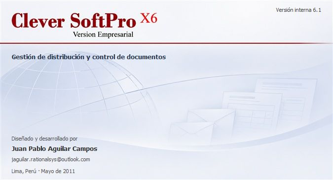
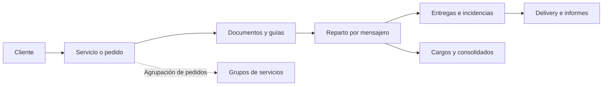
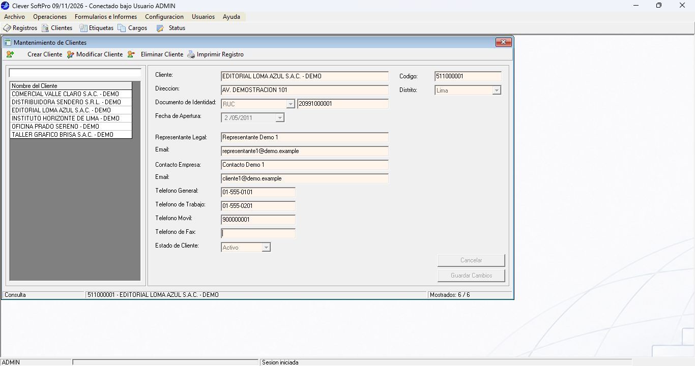
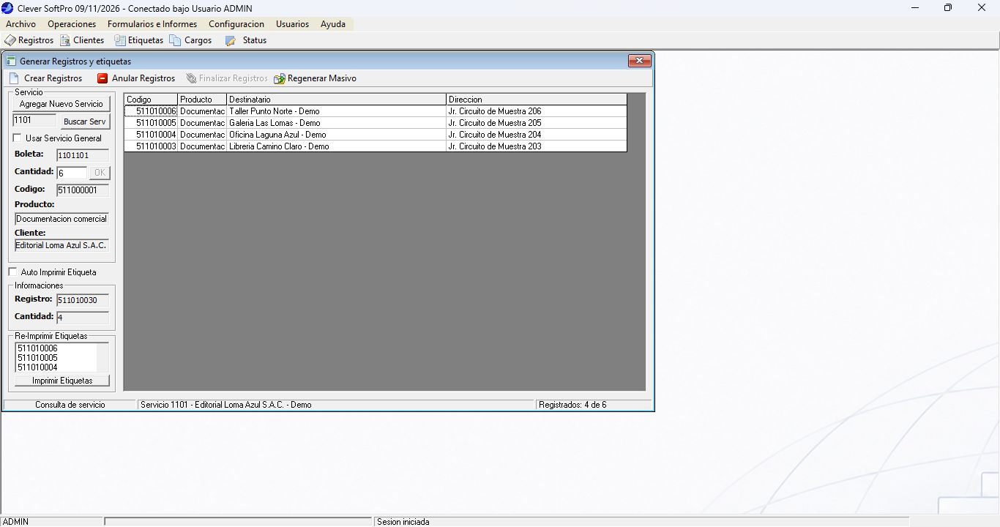
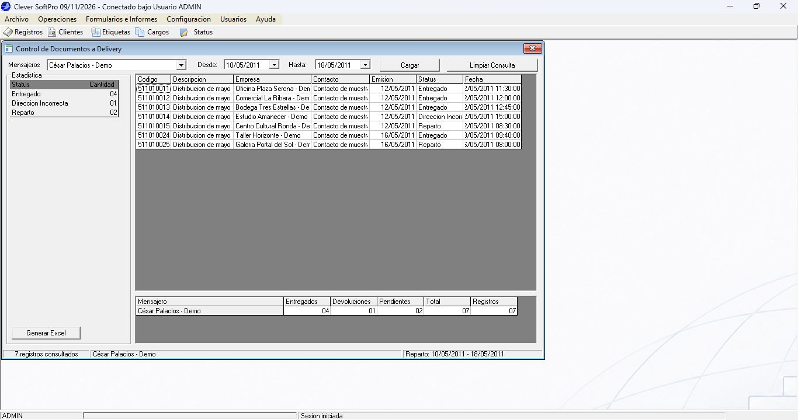

# Clever SoftPro X6 · LSLA

**Sistema de gestión para un courier local de Lima, Perú.**

Desarrollado en **mayo de 2011** por **Juan Pablo Aguilar Campos** para **Logistic & Solutions Latin American — LSLA**, con el propósito de acompañar el inicio de operaciones de la empresa y organizar el registro, la distribución y el control de sus documentos y cargos.

[Manual de uso](MANUAL_DE_USO.md) · [Instalación de la base de datos](BaseDatos/LEEME.md) · [Recorrido de demostración](BaseDatos/Demo/LEEME.md)

<p align="center">
  
</p>

## El problema que resuelve

Un courier necesita saber qué recibió de cada cliente, cuántos documentos debe distribuir, a quién se asignó cada guía y cuál fue el resultado de la entrega. También necesita emitir cargos, reunir pedidos relacionados y presentar avances sin perder la relación entre el documento, su destinatario y su historial.

Clever SoftPro X6 reúne ese trabajo en una aplicación de escritorio. El servicio representa el pedido de un cliente; las guías representan sus documentos. A partir de ellos se organiza el reparto, se registran entregas e incidencias y se consultan resultados por mensajero, cliente o servicio.

## Flujo de trabajo



Los grupos permiten reunir servicios para su consulta y control conjunto. Los consolidados complementan los cargos de reparto y los perfiles de usuario delimitan el acceso a las distintas áreas.

## Funciones

| Área | Trabajo que permite realizar |
| --- | --- |
| Clientes | Registrar y consultar clientes, actualizar sus datos y gestionar bajas conservando sus relaciones. |
| Servicios y documentos | Crear pedidos con boleta, producto y cantidad; registrar guías manualmente o mediante Excel; finalizar y reactivar servicios. |
| Grupos de servicios | Reunir pedidos, consultar sus documentos, retirar servicios del grupo y obtener resúmenes. |
| Reparto y cargos | Asignar documentos a mensajeros, emitir cargos numerados, regenerarlos y liberar guías para una nueva asignación. |
| Consolidados | Preparar la relación de documentos del reparto mediante el informe de VB6. |
| Confirmaciones | Registrar entregas e incidencias por lote, con fecha, hora y observación; consultar el historial del documento. |
| Delivery | Consultar documentos por mensajero e intervalo de reparto, con cantidades entregadas, pendientes y devueltas. |
| Informes | Elegir columnas y filtros, generar Excel y texto tabulado, e imprimir resultados. |
| Configuración | Mantener los estados del documento y consultar el catálogo de distritos. |
| Actualizaciones | Exportar e importar archivos de intercambio entre instalaciones compatibles. |
| Usuarios | Administrar cuentas, claves, perfiles y permisos por módulo. |

## El sistema en pantallas

Capturas de la aplicación con el conjunto de demostración ficticio de mayo de 2011.

### Clientes y datos del pedido

La ficha del cliente reúne su identificación, dirección y contactos. El estado permite conservar su información y sus relaciones con los servicios anteriores.

[](Documentacion/Imagenes/clientes.png)

### Del servicio a sus guías

El servicio `1101` representa un pedido de seis documentos. La consulta muestra cuatro guías registradas y su relación con el cliente, el producto y los destinatarios; quedan dos por registrar. Desde este módulo se trabaja con la carga manual, Excel y las etiquetas.

[](Documentacion/Imagenes/servicios.png)

### Seguimiento del reparto

Delivery consulta las guías asignadas a un mensajero dentro de un intervalo de reparto y presenta su estado actual. En el caso de César Palacios, del 10 al 18 de mayo de 2011, la demo contiene siete documentos: cuatro entregados, una devolución y dos pendientes.

[](Documentacion/Imagenes/delivery.png)

Las capturas pueden abrirse para verlas a tamaño completo. El [manual de uso](MANUAL_DE_USO.md) explica el recorrido de los demás módulos.

## Tecnología

- **Visual Basic 6.0**: aplicación de escritorio con formularios MDI.
- **SQL Server**: tablas, claves, relaciones, índices, vistas y procedimientos almacenados.
- **ADO** y **SQLOLEDB.1**: acceso a datos y operaciones transaccionales.
- **Controles OCX**: listas, cuadrículas, árboles, fechas y selectores de archivos.
- **Data Report de VB6** e impresión nativa sobre hojas.
- **Microsoft Excel** mediante automatización COM, con archivos `.xls` y `.xlsx`.
- **MD5** para las claves de acceso de la aplicación.

## Probar la demostración

El repositorio contiene una instalación SQL completa y una carga independiente de información **enteramente ficticia**, situada en **mayo de 2011**. Incluye cuentas de ambos perfiles, clientes, destinatarios, servicios, guías, cargos, consolidados e historiales.

Desde la raíz del repositorio, en un equipo con SQL Server y `sqlcmd`:

```powershell
sqlcmd -S 'localhost\SQLEXPRESS' -E -b -f 65001 -v NombreBase="DCSP_Demo" -i BaseDatos\InstalarDemo.sql
```

La instalación exige un nombre de base nuevo y no sobrescribe una base existente. En entornos que utilicen un certificado local de SQL Server, puede ser necesario añadir `-C` a `sqlcmd`.

Después, copiar [Config/Clever.example.ini](Config/Clever.example.ini) a `Config/Clever.local.ini` e indicar `Base=DCSP_Demo`. Abrir [Clever.vbp](Clever.vbp) en VB6 y generar el ejecutable en la raíz del proyecto.

**Acceso demo:** usuario `ADMIN`, clave `Demo2011`. Las demás cuentas y los casos listos para usar están en el [recorrido de demostración](BaseDatos/Demo/LEEME.md).

Se necesitan VB6, los componentes COM indicados en la [guía de instalación](BaseDatos/LEEME.md) y Excel para las funciones de importación y exportación. Los controles de terceros y sus licencias se obtienen por separado.

## Contenido del repositorio

```text
Clever.vbp             Proyecto de Visual Basic 6.0
src/                   Formularios, módulos, clases y recursos
src/Reportes/          Informe de consolidado
BaseDatos/             Creación e instalación completa de SQL Server
BaseDatos/Demo/        Datos ficticios y recorrido de demostración
Config/                Ejemplo de configuración de conexión
Documentacion/Imagenes/ Capturas de la aplicación con datos demo
MANUAL_DE_USO.md       Uso de los módulos y flujo de operación
```

El intercambio SQL requiere catálogos e identidades compatibles entre instalaciones; no es una sincronización automática entre bases que escriban independientemente. La impresión física debe comprobarse con la impresora de destino.

## Autor

**Juan Pablo Aguilar Campos**  
Lima, Perú · Mayo de 2011  
[jaguilar.rationalsys@outlook.com](mailto:jaguilar.rationalsys@outlook.com)
